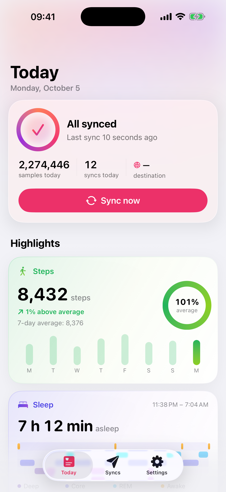
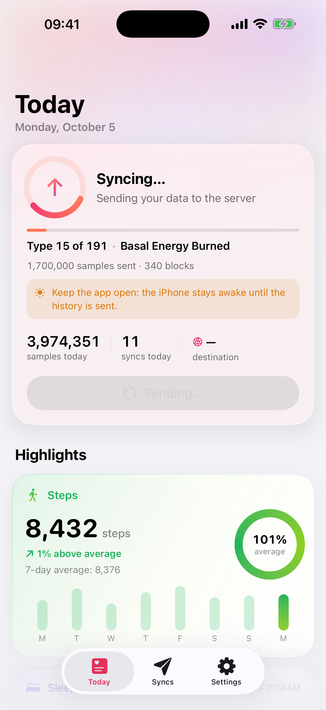
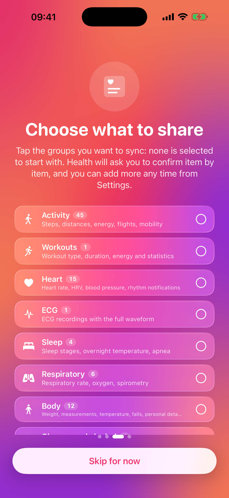
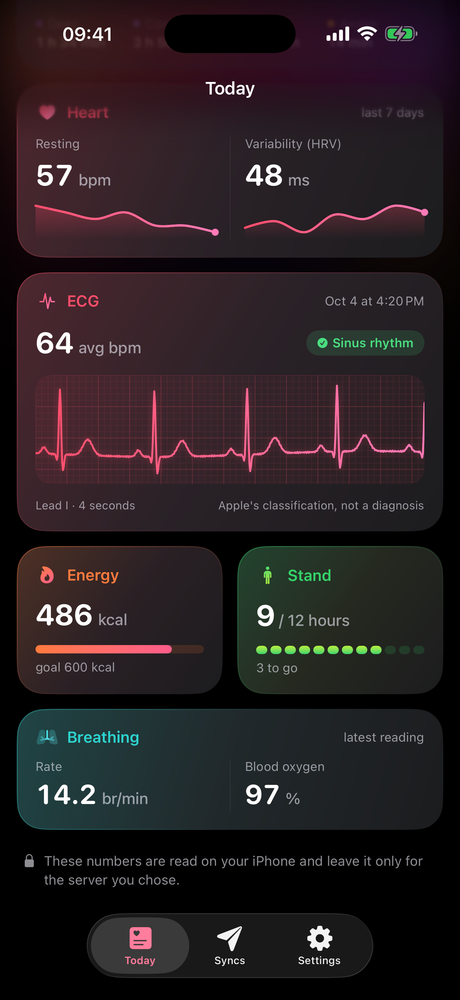

# Sync for Health

Free, open-source iPhone app that reads the Apple Health data **you authorize** and sends it,
incrementally and also in the background, to an **HTTPS server you choose**.
No account, no subscription, no developer server in between.

*Italiano più sotto.*

<p>




</p>

## What it does

- **Everything**: 192 HealthKit types in the catalog (119 quantities, 69 categories, workouts,
  ECG with the full µV waveform, audiograms, state of mind, characteristics).
- **Permissions by group** (Activity, Workouts, Heart, ECG, Sleep, Respiration, Body, Glucose & alcohol,
  Nutrition, Hearing, Mindfulness, Cycle, Symptoms, Hygiene). Nothing is preselected; add groups later
  from Settings and Health asks only for the new types. GPS workout routes are **off by default**.
- **Full history**: the first sync sends everything in batches of up to 5000 items and **resumes**
  after interruptions. A per-type `HKQueryAnchor` is saved **only after a 2xx response**, so a failed
  send never loses data. Progress shows "type N of M".
- Afterwards only **new data and deletions** are sent: `HKObserverQuery` + background delivery,
  plus `BGAppRefreshTask` / `BGProcessingTask`, "Sync now" and pull-to-refresh.
- **Demo mode** with synthetic data (Settings › Demo mode, or "No server? Try with sample data" on the
  first screen): nothing real is read or sent.
- Read-only: the app never writes to Health.

## Privacy

Data goes **only** to the address you enter. There is no Sync for Health server.
No analytics, no ads, no third-party SDK, no iCloud (app files are excluded from iCloud backup),
no external dependency. The optional token is stored in the Keychain
(`AfterFirstUnlockThisDeviceOnly`). `http://` is allowed only to local-network addresses.
App Store privacy label: **Data Not Collected**. See `SaluteLibera/Resources/PrivacyInfo.xcprivacy`
and the [privacy policy](https://vcnngr.github.io/sync-for-health/privacy.html).

## Protocol

Each sync is a JSON `POST` (optional gzip) with an optional `Authorization: Bearer <token>` header.
Full format, units per type and response rules: **[docs/PROTOCOL.md](docs/PROTOCOL.md)** (Italian).
A test receiver is included:

```sh
python3 tools/ricevitore_prova.py --porta 8787
```

## Build

Requirements: Xcode 26.2+, iOS 26, [XcodeGen](https://github.com/yonaskolb/XcodeGen). No third-party dependencies.

```sh
xcodegen generate
xcodebuild -project SaluteLibera.xcodeproj -scheme SaluteLibera \
  -destination 'platform=iOS Simulator,name=iPhone 17 Pro' \
  -derivedDataPath build/DD CODE_SIGNING_ALLOWED=NO build
```

To run on a device set your own `DEVELOPMENT_TEAM` and bundle id in `project.yml`.
Debug builds accept launch arguments for screenshots (`-demo`, `-onboarding`, `-pagina N`,
`-tab invii|impostazioni`, `-autoSync`, `-fondo`). App Store screenshots: `tools/screenshot_appstore.sh`.

## Layout

```
SaluteLibera/   App, Health (catalog, serializer), Model, Sync, UI, Demo, Resources
docs/           PROTOCOL.md, appstore/ (listing texts and screenshots)
site/           static privacy policy and support page (GitHub Pages)
tools/          test receiver, icon, translations, screenshots
```

## Support

expert@slackarea.net — please start the subject with **"Sync for Health"**.

## License

[MIT](LICENSE) © 2026 Vincenzo Ingrosso

---

## Italiano

App per iPhone gratuita e a codice aperto: legge i dati di Salute che **autorizzi tu** e li invia, solo le
novità e anche in background, a un **server HTTPS scelto da te**. Niente account, niente abbonamenti, nessun
server dello sviluppatore in mezzo.

- 192 tipi di Salute, ECG con il tracciato completo; permessi **per gruppi**, nessuno scelto in partenza;
  percorsi GPS spenti di serie.
- Tutto lo **storico** al primo invio, a blocchi, con **ripresa** automatica: il segnalibro si salva solo
  dopo una risposta 2xx. Avanzamento «tipo N di M».
- **Modalità dimostrativa** con dati inventati.
- I dati vanno **solo** al tuo server: nessuna analisi, pubblicità, SDK, iCloud.
  [Informativa privacy](https://vcnngr.github.io/sync-for-health/privacy.html) ·
  [Assistenza](https://vcnngr.github.io/sync-for-health/).

Licenza [MIT](LICENSE).
